  

### 👋 Oi, eu sou o Garrido

- 🔭 **Aberto para projetos:** sites, agendamento online, cardápio digital e galerias de entrega de fotos
- 🏪 **Foco:** comércio local, como estúdios, restaurantes, fotógrafos e agências
- 📈 **Diferencial:** também trabalho com marketing digital, então cada página é pensada para trazer cliente
- ⚡ **Curiosidade:** todo cliente pede "só um ajustezinho", e nunca é um só

### 🧰 Equipamento

  
  
  
  
  
  
  
  
  
  
  
  

### 🗺️ Níveis concluídos

  
  
  
  

### 🎮 Ficha do jogador

  

  <picture>
    <source media="(prefers-color-scheme: dark)" srcset="https://raw.githubusercontent.com/garridodev51-pixel/garridodev51-pixel/output/cobrinha-escura.svg">
    <source media="(prefers-color-scheme: light)" srcset="https://raw.githubusercontent.com/garridodev51-pixel/garridodev51-pixel/output/cobrinha.svg">
    
  </picture>

### 🧭 Do pedido ao site no ar

  

  

<!--
### 📫 Fale comigo
Troque pelos seus links e apague esta linha, a primeira e a última deste bloco.

  
  
  
  

-->
