

  

  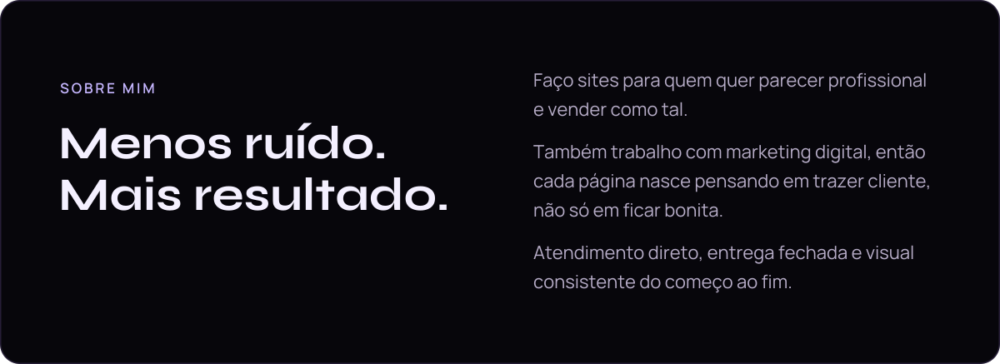

  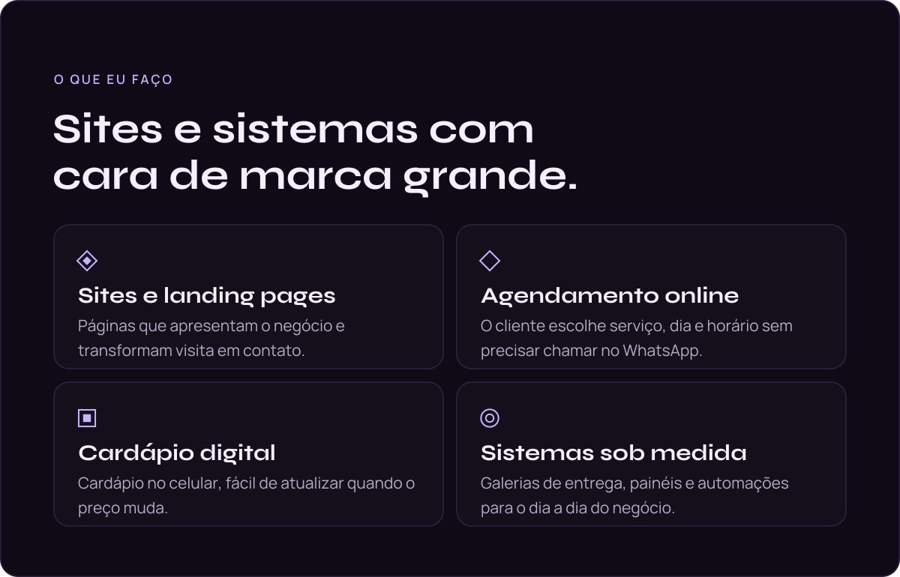

  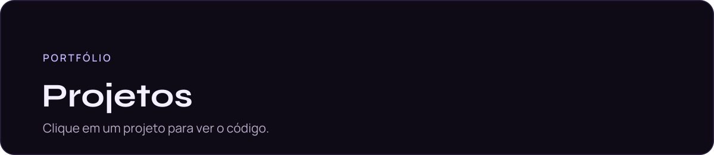

  <a href="https://github.com/garridodev51-pixel/bia-nail-studio">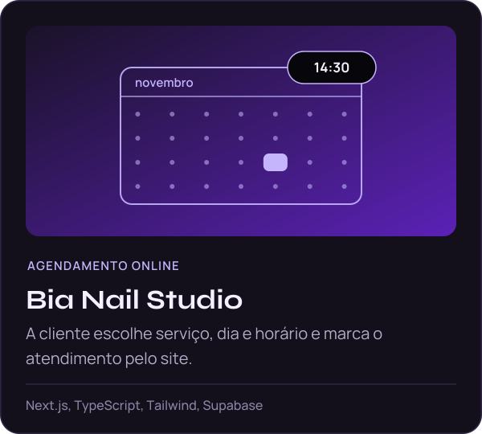</a>
  <a href="https://github.com/garridodev51-pixel/atelier-entrega">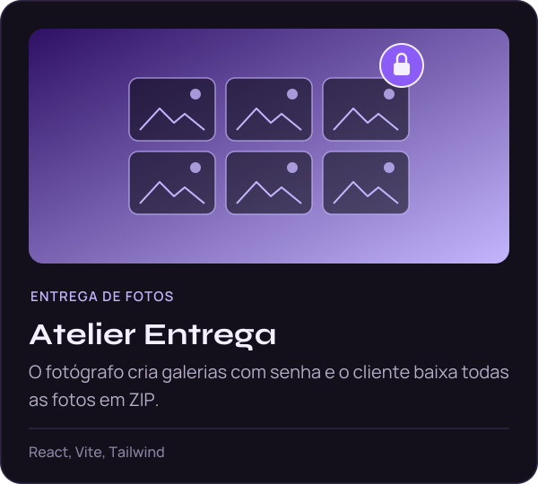</a>

  <a href="https://github.com/garridodev51-pixel/o-camarote-cardapio">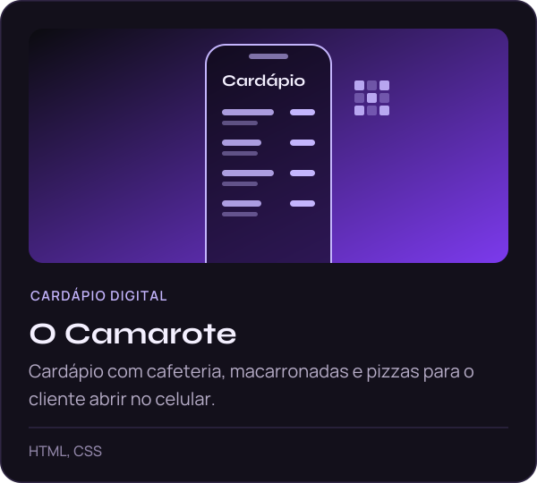</a>
  <a href="https://github.com/garridodev51-pixel/agencia-egon">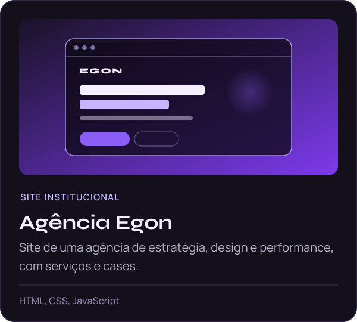</a>

  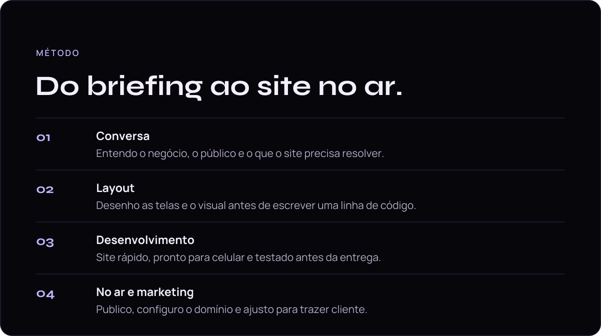

  <a href="https://github.com/garridodev51-pixel?tab=repositories">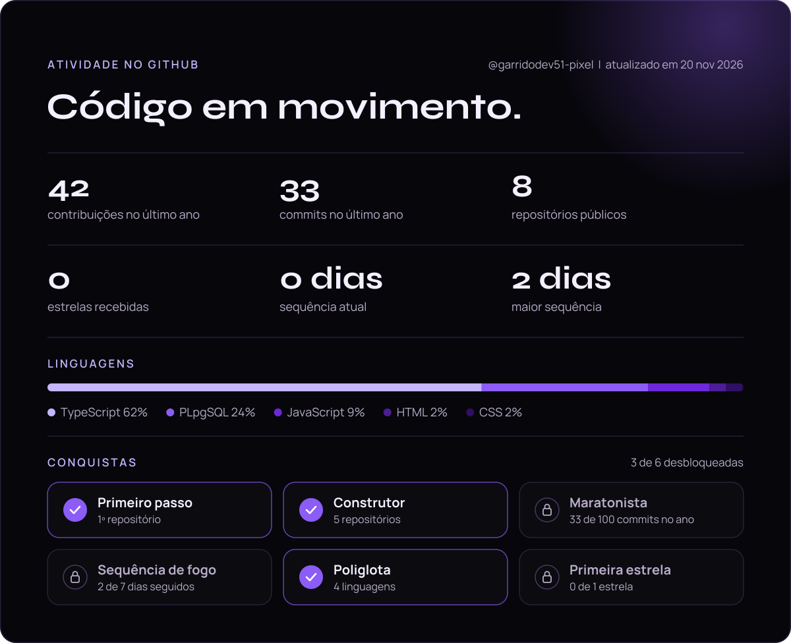</a>

  <picture>
    <source media="(prefers-color-scheme: dark)" srcset="https://raw.githubusercontent.com/garridodev51-pixel/garridodev51-pixel/output/cobrinha-escura.svg">
    <source media="(prefers-color-scheme: light)" srcset="https://raw.githubusercontent.com/garridodev51-pixel/garridodev51-pixel/output/cobrinha.svg">
    
  </picture>

  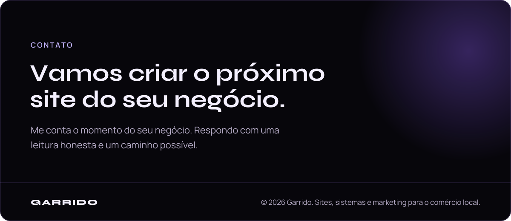

<!-- Botões de contato: me mande WhatsApp, Instagram e e-mail para eu gerar os botões no mesmo estilo. -->
